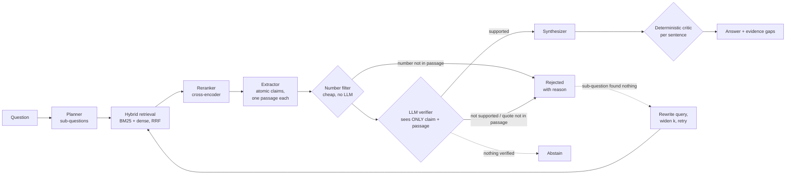

# Agentic Research Analyst with Evidence Verification

A research assistant that answers questions from a collection of papers with **claim-level citations**. It **verifies every claim against the single passage it cites** before that claim can reach the answer, and it **abstains or names the gap** when the collection doesn't support an answer. It ships with an evaluation harness built to answer one question honestly:

> **Does verifying claims against their sources reduce unsupported statements compared with standard RAG, and what does it cost in coverage, latency and money?**

Domain: 5G/6G handover, mobility management and network security (open-access arXiv papers).

> **Status: In development.** The system, the evaluation harness and the test suite are complete and run offline. The headline comparison on the real corpus has **not been run yet**: it needs the paper corpus and the hand-labelled question set (see [Roadmap](#roadmap)). No result below comes from the real corpus, and every number says what data it comes from.

---

## How it works



The parts that make the citations trustworthy:

| Safeguard | What it catches | How it's built |
|---|---|---|
| One passage per claim | Claims "supported" by a blend of passages | The verifier sees only the claim and its own passage, never the wider context |
| Number filter | Changed or invented numbers | Deterministic. Runs before the LLM verifier, so obviously wrong claims cost no LLM call |
| LLM verifier with quote check | Flipped directions, dropped hedges, overreach | The verifier has to quote its evidence. If the quote isn't in the passage, the claim is rejected (it fails closed, as it does on unparseable output) |
| Sentence-level critic | Synthesizer adding facts while it rewrites | Each answer sentence has to cite verified claims, and every number in it has to appear in those claims. Sentences that fail are dropped, not the whole answer |
| Abstention and evidence gaps | Answering from nothing | No verified claims means the system abstains. A sub-question with no verified evidence is listed as a gap instead of being papered over |

## What gets measured

Six systems answer the same questions. Each ablation removes one component:

| System | Retrieval | Planner | Verifier | Critic |
|---|---|---|---|---|
| `bm25_rag` | BM25 | - | - | - |
| `hybrid_rerank_rag` | BM25 + dense (RRF) + cross-encoder | - | - | - |
| `agentic_full` | same | yes | number filter + LLM | yes |
| `no_planner` / `no_verifier` / `no_critic` | same | ablated one at a time | | |

**Metrics** (defined in [`eval/metrics.py`](eval/metrics.py)). Every system is graded on the sentences it actually outputs, so the baseline and the agentic system are scored the same way:

- **Unsupported-statement rate:** cited answer sentences that the judge finds unsupported by the passages they cite
- **Completeness:** fraction of hand-written gold facts the answer states
- **Gold evidence retrieved / cited:** whether the passages a human marked as evidence were found and used
- **Abstention:** answers to unanswerable questions, and false abstentions on answerable ones
- **Cost:** p50/p95 latency, LLM calls, tokens and dollars per question

**Statistics.** 95% bootstrap CIs resample *questions* (claims within one answer are correlated, so a per-claim Wilson interval would be too narrow). Systems are compared with **paired** tests on the same questions (bootstrap CI plus a sign-flip permutation p-value), Holm-adjusted across comparisons.

**Guarding against fooling ourselves:**
- **Judge ≠ verifier.** The judge uses a different prompt and a different model from the system's verifier. The runner warns if they match.
- **Judge validated against humans.** A blind, stratified sample is hand-labelled and agreement is reported as Cohen's κ, with the judge's own labels hidden while you label. Judge-based numbers aren't reported without this.
- **Gold stored as quotes, not passage IDs.** Re-chunking the corpus can't silently invalidate the labels.
- **Held-out test split.** It needs `--confirm-test`, and every test-split run is logged, so the number reported isn't the best of several tries.
- **No hidden fallbacks.** If a neural backend isn't installed, the stand-in (LSA, lexical reranker) is named in every results table. `require_neural: true` makes the main config fail instead.
- **Spend cap and caching.** Spend is capped per run, and partial results are written if the cap is hit. Every LLM response is cached, so a rerun costs nothing.

## Results so far

### Verifier stress test: what does a lexical verifier let through?

The test samples real sentences, perturbs each one so its meaning changes, and checks whether the verifier still accepts it against the original passage. No hand labels are needed, so it runs on any corpus ([`eval/verifier_stress.py`](eval/verifier_stress.py)).

Run so far only on the **28 sentences of the synthetic fixture corpus**, with the two lexical verifiers. (`lexical_v1` is the check the original prototype used.)

| Claim type | Should be | n | lexical_v1 (numbers only) | lexical_v2 (+ negation) |
|---|---|---|---|---|
| original sentence | accepted | 28 | 100% | 100% |
| number changed | rejected | 10 | **0%** false accepts | **0%** |
| negated | rejected | 7 | 100% false accepts | **0%** |
| direction flipped ("reduces"→"increases") | rejected | 7 | 100% | 100% |
| hedge removed ("may"→"will") | rejected | 3 | 100% | 100% |
| qualifier dropped ("simulated", "synthetic") | rejected | 6 | 100% | 100% |
| technical term swapped | rejected | 28 | 100% | 100% |

**Reading:** word-overlap verification only catches changed numbers (and negation, once that check was added). It accepts every flipped direction, dropped qualifier and swapped term, and these are the errors that matter most in a literature review ("worked in simulation" becoming "works"). That is why the full system keeps the number check as a free first-pass filter and sends everything else to an LLM verifier. The open question, which the real run answers, is how much of this gap the LLM verifier closes: `make stress LLM=configs/main.yaml` adds that column. Small n, synthetic sentences: treat this as a mechanism check, not an estimate.

### Harness check: can the evaluation detect the effect at all?

Before spending money on the real run, the harness was itself tested. A scripted fake LLM plants
three realistic errors: the extractor invents a number and flips a claim, and the synthesizer adds
an unsupported statistic. Then the full runner runs with parallel workers. The full system ends at
0% unsupported statements, while the RAG baseline, `no_verifier` and `no_critic` each let their
planted error through, and the paired comparison flags it
(`tests/test_eval.py::test_runner_llm_mode_with_fake_model`). This shows the instrument works,
not how often a real model makes these errors.

### Main comparison and retrieval comparison

*Pending the real corpus and question set.* `make eval` and `make retrieval` write the tables to `results/<experiment>/<timestamp>/summary.md` in the format of [the smoke run](#quickstart). Copy the reported runs into `results/reported/`.

## Quickstart

```bash
pip install -r requirements-dev.txt     # Python 3.10+
make test                                # ~60 tests, offline, ~5 s
make smoke                               # all 6 systems end to end on the synthetic fixture (plumbing, not results)
```

Ask it something with the offline heuristics, or with an LLM:

```bash
pip install -r requirements-serve.txt
make demo                                # Streamlit: answer, per-claim verdicts, evidence, rejected claims, trace
make api                                 # POST /ask {"question": "..."} -> answer, claims, sources, cost
ARA_CONFIG=configs/main.yaml make demo   # LLM mode (needs ANTHROPIC_API_KEY and the real corpus)
```

### Full experiment (real corpus)

```bash
pip install -r requirements-ml.txt                  # sentence-transformers, FAISS
python scripts/fetch_arxiv.py search                # candidates + licence for each paper
#   curate 40-60 rows into data/papers/manifest.csv (include=1)
make corpus                                         # download pinned versions, extract text
#   write data/questions.jsonl (see docs/EVALUATION.md); make validate
make retrieval                                      # milestone 3
make stress LLM=configs/main.yaml                   # verifier false-accept rates incl. LLM verifier
make eval                                           # milestone 5: dev split, all systems + ablations
python -m eval.judge_agreement export results/main_comparison/<run>   # label 30 items, then:
python -m eval.judge_agreement score
make failures                                       # failure cases for hand-coding
make eval-test                                      # once, at the end
```

The step-by-step version, with time and cost notes, is in [docs/RUNBOOK.md](docs/RUNBOOK.md).

## Repository layout

```
common/            shared foundation for all three portfolio projects
  llm.py           Anthropic + OpenAI-compatible (Ollama/vLLM) clients: cache, retries, cost, spend cap
  tracing.py       JSONL trace of every step and LLM call, per question
  stats.py         bootstrap, paired permutation tests, Holm, Wilson, Cohen's kappa
  config.py        YAML configs + provenance (git commit, package versions, backends)
ara/               the research analyst
  corpus.py        section-aware chunking, quote -> passage resolution
  retrieval/       BM25, dense (SBERT/FAISS), RRF hybrid, rerankers
  agents.py        planner, extractor, verifier, synthesizer, critic (+ versioned prompts)
  pipeline.py      RAG baseline and agentic system, configurable for ablations
eval/              run.py (experiments), retrieval_eval, verifier_stress, judge_agreement,
                   failures, validate, label_helper, metrics, report
scripts/           fetch_arxiv.py (licence-aware), ingest.py (two-column-aware PDF extraction)
api/  app.py       FastAPI service, Streamlit demo
configs/           one YAML per experiment
docs/              DESIGN.md, EVALUATION.md, RUNBOOK.md
```

## Limitations

- **No real-corpus results yet.** The comparison above is designed and runnable but hasn't been run.
- **The synthetic fixture** (6 short documents written for testing) exercises the code. It carries no evidence about the research question.
- **Offline mode** uses heuristics for planning, extraction and verification so tests run anywhere. Baseline and agentic results there are expected to look alike, because the interesting differences only appear when an LLM can hallucinate.
- **LLM-judge metrics** are only as good as the judge's measured agreement with hand labels.
- **Scale:** designed for tens to a few hundred papers. Exact vector search is used, and there is no live web search.
- **The question set is written by one person**, so it carries that person's framing. Unanswerable questions are in-domain on purpose, so that abstention is actually tested.

## Roadmap

Milestones from the project plan:

| # | Milestone | Status |
|---|---|---|
| 0 | Shared foundation (LLM wrapper, tracing, stats, configs, CI) | Done |
| 1 | Corpus: 40+ papers, licence log, clean text | Tooling done (`fetch_arxiv.py`, `ingest.py`); papers to be curated |
| 2 | Eval set: ~100 questions with gold quotes, 20 held out | Schema, validator and labelling helper done; questions to be written |
| 3 | Retrieval upgrade beats BM25 on Recall@5, or the negative result is documented | Implemented; to be measured |
| 4 | LLM verifier; judge agreement on 30 hand-labelled items | Implemented; to be measured |
| 5 | All systems and ablations with confidence intervals | Implemented; to be run |
| 6 | Write-up: results, failure cases, cost, latency | Tooling done (`failures.py`, `summary.md`); to be written |
